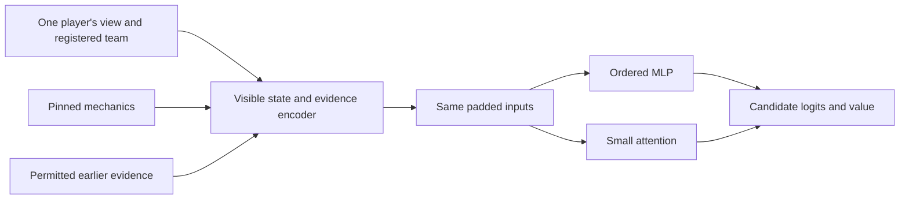

# Player observations and untrained model candidates

PKA-038 implements two runnable hypotheses, not trained Pokémon agents. PPO,
trainer selection, reward shaping and search remain separate experiments.

## Run locally

Prepare the pinned engine using the [foundation commands](../planning/pokemon/foundation/README.md).

```bash
uv sync --locked --all-packages --extra learning
uv run --locked --all-packages --extra learning pytest packages/python/strixia_agon/tests/test_representation.py packages/python/strixia_agon/tests/test_models.py packages/python/strixia_agon/tests/test_model_probe.py
uv run --locked --all-packages --extra learning python scripts/pokemon_models.py tmp/model-probes/new-run --mps
```

The optional learning extra installs PyTorch 2.14.1. Ordinary simulation and observation
construction do not import Torch. The explicit learning test command must complete
without skipped tests. CPU is required; `--mps` requests an additional Apple GPU pass.
There is no automatic device fallback. Windows/CUDA and PufferLib are PKA-039.

The probe creates a new Git-ignored directory exclusively. It records configuration,
versions, source commit/dirty status, mechanics hash and individual case results.
Every case runs in a fresh child process, with one CPU thread, five warm-up passes
and fifty timed inference passes. Each case has a 180-second result-wait limit plus bounded child cleanup; failures
retain their actual requested dimensions and never become shorter successful cases.
A completed matrix containing failed cases exits nonzero after saving results.

The matrix is two architectures × preview/ordinary menus × 16/64/256 history
records × batch sizes 1/8/32 × requested devices. Menus originate in real pinned-engine
fixtures. Repeated histories are explicitly synthetic performance workloads, not
measured battle trajectories or evidence of strategic ability. Synthetic records
retain their contextual tokens; sequence positions are updated, while repeated
payloads/turns remain artificial.

Batch construction is measured separately from forward inference. Device synchronization
is included. Child peak RSS includes imports, model, tensors and inference; Python
tracemalloc excludes native tensors. MPS allocation readings are end-of-case snapshots,
not GPU peaks. Measurements on a development machine are exploratory; they do not
establish trainer throughput or an architectural winner.

## Library interface

`load_mechanics(checkout)` exports static Champions Dex data only and checks the
engine revision. Available Dex metadata includes nonstandard species/moves; it is
not an alternative legality validator. Existing M-C validation and menus determine
what can actually be used.

`encode(view, own_team, mechanics, context=None)` accepts one player's view and that
player's registered team. `EvidenceContext` holds permitted earlier records, game
number and an optional prior-record sequence cutoff. These are trusted internally
produced records, not a public replay-import or arbitrary belief interface.

Same-game public evidence must match the current history prefix. Evidence is bound to its player perspective; per-player revisions reject later
private request revelations even when public history and turn are identical. Earlier private
snapshots remain private, and another player's private records are rejected. An
older view cannot accept future records. A new game retains historical records but
rebuilds battlefield state from its own history. Supply the saved earlier view to
reconstruct an earlier decision; a context cutoff does not rewind a newer view.
Each encoding adds a dated own-state snapshot. It includes available private HP,
stats and active-move PP; missing information is explicitly unknown.

`batch(observations, device)` dynamically pads the full histories, event contexts,
field tokens and candidate menus. Mixed schema/mechanics identities are rejected.
There is no history cap. Frozen containers do not make Torch tensor storage immutable;
callers must not modify a batch in place.

`PolicyValueModel(vocabulary_size, kind="mlp"|"attention")` returns logits, a scalar
expected-outcome estimate and a candidate mask. `output.probabilities()` gives zero
probability to padding and terminal rows. The value is unconstrained and uncalibrated.
Candidate index `i` maps directly back to `observation.candidates[i].choice`.

## Architectures

Both candidates share the same encoder design, inputs and candidate scorer; their
weights are independent. Categorical slots are bound before pooling so registered
and current identities remain distinguishable. Numeric values travel with explicit
state masks. Each feature token projects to 128 dimensions.

- MLP: ordered twelve Pokémon embeddings, pooled field and full-history embeddings,
  followed by two 256-unit layers.
- Attention: two blocks, width 128, four heads and feed-forward width 256; explicit
  entity/role identities and unbounded sinusoidal chronological positions.
- Both: each event includes its features and pooled contextual tokens; each action
  part includes its features plus actor/target embeddings. Up to four ordered parts
  preserve preview ordering and coordinated actions. Shared state feeds policy and
  value heads. No recurrent hidden state exists.



Full history means all records reach the input boundary; it does not promise lossless
neural memory. The MLP pools history, both models pool event context, and attention
has finite capacity. Whether these representations retain useful strategy is a
learning experiment in PKA-040, not a result established here.

## Decisions to revisit

| Decision | Current choice | Revisit with evidence |
| --- | --- | --- |
| History | Full ordered records, no truncation | Memory/latency and learning comparisons before compression |
| Memory | Explicit facts/history; no recurrence | Long-context and future Bo3 adaptation tests |
| Actions | Score entire existing paired menu | Measured encoding/coordination failures, never local slot pruning |
| Architecture | Keep both untrained candidates | Equal-budget learning and held-out game outcomes |
| Mechanics | Versioned pinned metadata | Every future regulation and simulator update |

See the [feature specification](../planning/pokemon/foundation/038-model-inputs.md)
for normalization, evidence interpretation and unsupported protocol cases.

## Staged learning gates

| Stage | Evidence required before expansion | Story |
| --- | --- | --- |
| Input/model correctness | Privacy, chronology, menu semantics, masks and gradients | PKA-038 |
| Trainer compatibility | Correct transitions, resets and measured collection/update cost | PKA-039 |
| Controlled learning | Fixed reviewed M-C matchup/opponent; new evaluation seeds, swapped sides, repeated training seeds | PKA-040 |
| Reward comparison | Equal-budget outcome/shaping comparison judged by actual wins and tactical failures | PKA-040 |
| Small diverse pool | Per-matchup robustness beyond the initial scenario | PKA-041 |
| Broader training | Historical opponents, reproducible checkpoints and measured budgets | PKA-041/043/045 |
| Generalization | Familiar/unseen teams, BIG6 coverage and split/sampling sensitivity | PKA-035/042 |
| Bo3 and search | Correct evidence persistence/reset; depth-0 versus 1/2/3 turns under budgets | PKA-069/031 |

Each future story still requires a concrete approved experiment. Change one major
variable at a time; these notes authorize no training, hardware spend or new task.
